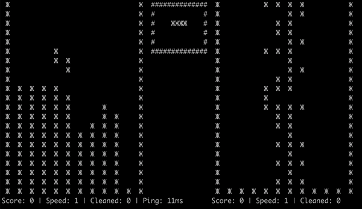
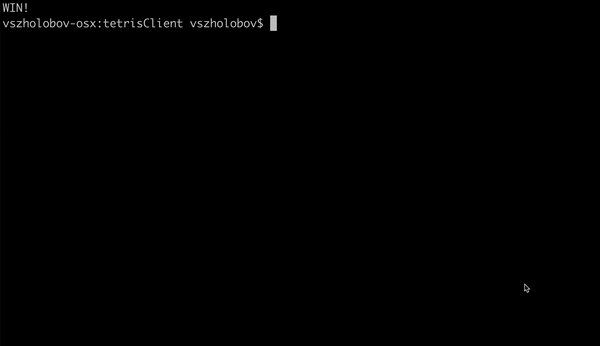

# Tetris Client

## Одиночная игра

Игра без сервера использует ту же логику фигур, столкновений, очистки строк
и подсчёта очков, что и сетевой режим. Общий движок находится в `lib/field`,
одиночная сессия — в `lib/single`. Сетевой режим запускается без аргументов.

```sh
cd client
go build -o tetrisClient .
./tetrisClient --single
```

Управление: `a`/`d` — влево/вправо, `s` — вниз, `q`/`e` — поворот,
`x`, Escape или Ctrl+C — выход. Поле рисуется ASCII-символами `#`.
Ввод идёт через `go-tty`, без ожидания Enter; режим терминала восстанавливается
при выходе. Нужен терминал с ANSI-командами перемещения курсора.

Очистка экрана остаётся внешней командой: `clear` в Linux/macOS,
`cmd /c cls` в Windows. Для OSel нужна Linux-сборка с `CGO_ENABLED=0`,
`/dev/tty` и исполняемая `/bin/clear` в `PATH`. Отсутствие команды очистки
даёт понятную ошибку при запуске одиночной игры.

Для воспроизводимого сквозного теста: `--single --seed 1 --trace`.
`--seed` фиксирует последовательность фигур; `--trace` печатает события
`TETRIS READY`, `TETRIS INPUT key=a changed=true`, `TETRIS TICK`, `TETRIS EXIT`.
Тест передаёт настоящие нажатия в терминал; таймер продолжает двигать фигуры.

Проверки: `go test ./...` отдельно в `lib`, `client` и `server`.

## Demo

### Scoring tetris:


### Full Game:


## Guide

### Controls
Controls are realised by buttons:
- a = move piece left
- s = move piece down
- d = move piece right
- q = rotate piece left
- e = rotate piece right

### Launch
Show help menu
```
./tetrisClient help
```

Launch menu
```
./tetrisClient
```

Create new session:
```
./tetrisClient create
```

Connect to existing session:
```
./tetrisClient connect 123456789
```

Show list of existing sessions:
```
./tetrisClient list
```
